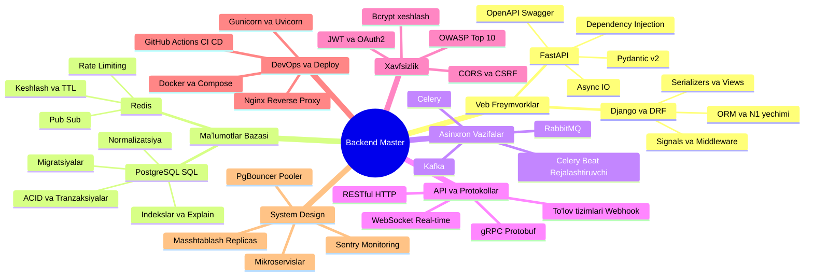

# 🚀 Python Backend Dasturchi Bilimlar Roʻyxati va Texnologiyalar Daraxti

Ushbu hujjat zamonaviy **Python Backend Dasturchisi** (Junior dan Middle/Senior darajagacha) bilishi kerak boʻlgan barcha asosiy texnologiyalar, arxitektura tamoyillari, maʼlumotlar bazasi, kesh, xabarlar navbati va xavfsizlik bilimlarini **daraxt (ierarxiya) koʻrinishida** jamlagan master yoʻl xaritasi (Roadmap) hisoblanadi.

---

## 🌲 1. Backend Texnologiyalar Daraxti (ASCII)

```text
🌐 BACKEND DASTURCHI BILIMLAR DARAХTI
│
├── ⚙️ 1. Dasturlash Asosi (Python Core & Architecture)
│   ├── OOP (Klasslar, SOLID tamoyillari, Design Patterns)
│   ├── Maʼlumotlar tuzilmasi va algoritmlar (Big-O, xotira optimizatsiyasi)
│   ├── Concurrency: AsyncIO (async/await), Threading, Multiprocessing
│   └── Tipizatsiya: Type Hints, Pydantic, Mypy
│
├── 🌐 2. Veb Freymvorklar (Web Frameworks)
│   ├── 🔹 Django & Django REST Framework (DRF):
│   │   ├── MVT arxitekturasi va Request-Response sikli
│   │   ├── ORM chuqurligi: select_related, prefetch_related (N+1 muammosi yechimi)
│   │   ├── Serializers, ModelViewSets, APIView, GenericViews
│   │   ├── Signals, Custom Middleware, Context Processors
│   │   └── Django Admin moslashtirish (customization)
│   └── 🔹 FastAPI:
│       ├── ASGI arxitekturasi (Uvicorn / Starlette asosida)
│       ├── Pydantic v2 (Validation, Serialization, Schemas)
│       ├── Dependency Injection (`Depends(...)`)
│       ├── Asinxron yoʻllar (`async def` vs `def`)
│       └── Avtomatik OpenAPI / Swagger hujjati
│
├── 🗄️ 3. Maʼlumotlar Bazasi (Databases & Storage)
│   ├── 🔹 RDBMS / SQL (PostgreSQL, MySQL):
│   │   ├── ACID tamoyillari (Atomicity, Consistency, Isolation, Durability)
│   │   ├── Tranzaksiyalar va Izolyatsiya darajalari (Isolation Levels)
│   │   ├── Indekslar (B-Tree, Hash, GIN) va `EXPLAIN ANALYZE` orqali tezlashtirish
│   │   ├── Normalizatsiya (1NF, 2NF, 3NF) vs Denormalizatsiya
│   │   ├── Bogʻlanishlar (1:1, 1:N, M:N) va CASCADE qoidalari
│   │   └── Migratsiyalar boshqaruvi (Django migrations, Alembic)
│   └── 🔹 NoSQL va In-Memory (Redis, MongoDB):
│       ├── Redis: Kesh (Cache-Aside, Write-Through), TTL, Invalidation
│       ├── Redis: Rate Limiting, Sessiyalar, Pub/Sub xabarlar
│       └── MongoDB: Hujjatga yoʻnaltirilgan maʼlumotlar (BSON, aggregatsiyalar)
│
├── 📨 4. Asinxron Vazifalar va Xabarlar Navbati (Async Tasks & Brokers)
│   ├── 🔹 Background Workers: Celery, Dramatiq, RQ
│   ├── 🔹 Message Brokers:
│   │   ├── Redis (broker / backend)
│   │   ├── RabbitMQ (AMQP, Exchange, Queues, Routing Keys)
│   │   └── Apache Kafka (Katta hajmli Event-Driven arxitektura)
│   └── 🔹 Rejali vazifalar (Cron / Celery Beat)
│
├── 🔌 5. Aloqa Protokollari va API Arxitekturasi
│   ├── 🔹 RESTful API (HTTP metodlar, Status kodlar, Idempotentlik)
│   ├── 🔹 WebSocket (Real-time aloqa, chatlar, jonli bildirishnomalar)
│   ├── 🔹 GraphQL (Over-fetching va Under-fetching muammolariga yechim)
│   ├── 🔹 gRPC & Protobuf (Mikroservislararo oʻta tezkor RPC aloqa)
│   └── 🔹 Webhooklar (Tashqi tizimlar, masalan: Click, Payme, Stripe integratsiyasi)
│
├── 🛡️ 6. Xavfsizlik va Autentifikatsiya (Security & Auth)
│   ├── Autentifikatsiya: JWT (Access & Refresh tokenlar), OAuth2, Session/Cookie
│   ├── Parollar xavfsizligi: Xeshlash algoritmlari (Bcrypt, Argon2, Salt)
│   └── OWASP Top 10 himoyalari:
│       ├── SQL Injection (ORM va parametrli soʻrovlar)
│       ├── CSRF (Cross-Site Request Forgery tokenlar)
│       ├── XSS (Cross-Site Scripting sanitizatsiyasi)
│       ├── CORS (Cross-Origin Resource Sharing toʻgʻri sozlami)
│       └── Rate Limiting & Brute-force himoyasi
│
├── 🐳 7. DevOps, Konteynerlar va Deploy (DevOps Basics)
│   ├── Docker: Dockerfile (Multi-stage build), `.dockerignore`
│   ├── Docker Compose: Servislarni (App + Postgres + Redis + Nginx) birga koʻtarish
│   ├── Web Server: Nginx (Reverse Proxy, Load Balancing, Gzip, SSL/TLS Let's Encrypt)
│   ├── Process Manager: Gunicorn (WSGI), Uvicorn (ASGI), Systemd
│   └── CI/CD: GitHub Actions (avtomatlashgan test, linting va VPSga deploy)
│
├── 🏗️ 8. Tizim Arxitekturasi va Masshtablash (System Design)
│   ├── Monolit vs Mikroservislar
│   ├── Keshlash darajalari (CDN -> Reverse Proxy -> App Cache -> DB Cache)
│   ├── Maʼlumotlar bazasini masshtablash:
│   │   ├── Master-Slave replikatsiya (Read Replicas)
│   │   ├── Connection Pooling (PgBouncer)
│   │   └── Sharding va Partitioning
│   └── Monitoring va Loglar: Sentry (xatolarni ushlash), Prometheus, Grafana, ELK/Loki
│
└── 🧪 9. Testlash va Kod Standartlari (Testing & Clean Code)
    ├── Testlar: Pytest, Unittest, Fixtures, Mocking, Test DB
    ├── Kod gigiyenasi: Ruff, Black, Flake8, Isort
    └── SOLID, DRY, KISS, YAGNI prinsiplari
```

---

## 📊 2. Vizual Xarita (Mermaid Mindmap)



---

## 🔬 3. Har Bir Boʻlim Boʻyicha Chuqur Bilimlar va Amaliy Naqshlar

---

### 🌐 1-BOʻLIM: Django va DRF ORM Chuqurligi (N+1 Muammosi)

Backend intervyularida eng koʻp tushadigan savol — bu maʼlumotlar bazasiga keraksiz koʻp soʻrov yuborish (N+1 muammosi).

#### ❌ Notoʻgʻri (N+1 xatoligi — har bir maqola uchun bazaga qayta soʻrov):

```python
maqolalar = Article.objects.all()
for m in maqolalar:
    print(m.author.username)  # 1 ta asosiy so'rov + N ta muallif so'rovi! (Baza qotadi)
```

#### ✅ Toʻgʻri yechim:

* `select_related()` — `ForeignKey` va `OneToOne` uchun SQL `INNER JOIN` yoki `LEFT JOIN` qiladi.
* `prefetch_related()` — `ManyToMany` va teskari `ForeignKey` uchun alohida 2 ta soʻrov qilib, xotirada birlashtiradi.

```python
# Faqat 1 ta so'rov bilan muallif ma'lumotlarini ham qo'shib oladi:
maqolalar = Article.objects.select_related("author").all()

# Many-to-Many uchun teglar bilan birga 2 ta so'rov:
maqolalar = Article.objects.prefetch_related("tags").all()
```

---

### ⚡ 2-BOʻLIM: FastAPI va Dependency Injection

FastAPI da `Depends` naqshi kodni modulli, xavfsiz va qayta ishlatiluvchi qilishning yuragi hisoblanadi:

```python
from fastapi import FastAPI, Depends, HTTPException, status
from fastapi.security import OAuth2PasswordBearer
from pydantic import BaseModel

app = FastAPI()
oauth2_scheme = OAuth2PasswordBearer(tokenUrl="token")

class User(BaseModel):
    id: int
    username: str

async def get_current_user(token: str = Depends(oauth2_scheme)) -> User:
    """Barcha himoyalangan endpointlar uchun bitta umumiy avtorizatsiya filtri"""
    if token != "maxfiy_token_123":
        raise HTTPException(
            status_code=status.HTTP_401_UNAUTHORIZED,
            detail="Token yaroqsiz"
        )
    return User(id=1, username="ali")

@app.get("/profil")
async def profile_view(user: User = Depends(get_current_user)):
    return {"status": "Xush kelibsiz", "user": user}
```

---

### 🗄️ 3-BOʻLIM: Maʼlumotlar Bazasi (PostgreSQL) va Indekslar

#### 1. ACID Tamoyili:

* **Atomicity (Boʻlinmaslik):** Barcha amallar yo toʻliq bajariladi, yoki umuman bekor qilinadi (Rollback).
* **Consistency (Izchillik):** Baza har doim oʻz qoidalariga (Constraint, Foreign Key) mos boʻlib qoladi.
* **Isolation (Ajratilganlik):** Parallel tranzaksiyalar bir-biriga xalaqit bermaydi.
* **Durability (Chidamlilik):** Muvaffaqiyatli saqlangan maʼlumot server oʻchib qolsa ham yoʻqolmaydi (WAL - Write Ahead Log).

#### 2. Indekslar:

Qidiruvni $O(n)$ dan $O(\log n)$ ga tushirish (B-Tree indeksi):

```sql
-- Ko'p qidiriladigan maydonlarga indeks berish:
CREATE INDEX idx_users_email ON users(email);

-- So'rov tezligini tekshirish:
EXPLAIN ANALYZE SELECT * FROM users WHERE email = 'ali@mail.com';
```

---

### 📨 4-BOʻLIM: Xabarlar Navbati va Fon Vazifalari (Celery + Redis)

Backend server foydalanuvchini kuttirmasligi kerak. Masalan: roʻyxatdan oʻtganda email joʻnatish, rasm oʻlchamini oʻzgartirish, PDF hisobot yasash fon rejimiga oʻtkaziladi:

```python
from celery import Celery

app = Celery("vazifalar", broker="redis://localhost:6379/0")

@app.task
def send_welcome_email(user_email: str):
    # Bu og'ir amal fonda Worker tomonidan bajariladi
    import time
    time.sleep(5)  # SMTP orqali email jo'natish
    print(f"Xat yuborildi: {user_email}")

# Asosiy API kodida:
# send_welcome_email.delay("ali@example.com") -> Mijoz 0.01 soniyada javob oladi!
```

---

### 🛡️ 5-BOʻLIM: Backend Xavfsizlik Qoidalari

| Xavf (Threat)           | Tavsif                                                     | Backend Yechimi                                                                     |
| ----------------------- | ---------------------------------------------------------- | ----------------------------------------------------------------------------------- |
| **SQL Injection** | Soʻrovga `OR 1=1; DROP TABLE` kabi kod kiritish         | ORM ishlatish yoki parametrli soʻrovlar (`cursor.execute(sql, [param])`)         |
| **XSS**           | Foydalanuvchi orqali `<script>` kod kiritilishi          | Chiqish matnlarini HTML escape qilish, Jinja2/React avto-escape                     |
| **CSRF**          | Brauzer cookiesidan foydalanib aldovchi soʻrov joʻnatish | CSRF tokenlar va SameSite cookie (`SameSite=Lax/Strict`)                          |
| **Brute Force**   | Parollarni qayta-qayta terib koʻrish                      | Redis orqali Rate Limiting (masalan, 1 daqiqada max 5 ta soʻrov)                   |
| **CORS**          | Ruxsatsiz domendan API ga soʻrov yuborish                 | Faqat oʻz frontend domeniga ruxsat berish (`allow_origins=["https://myapp.uz"]`) |

---

### 🐳 6-BOʻLIM: Docker va Production Stack

Zamonaviy ishlab chiqarish (production) muhitida tizim odatda quyidagi arxitekturada joylashadi:

```text
[Mijoz / Brauzer]
       │
       ▼ (HTTPS: 443)
┌──────────────────────────────────────────────┐
│                  NGINX                       │
│  (Reverse Proxy, Static Files, SSL/TLS, Gzip)│
└──────────────────────┬───────────────────────┘
                       │ (Proxy Pass)
                       ▼
┌──────────────────────────────────────────────┐
│          APP (FastAPI / Gunicorn)            │
│         Konteyner: Python Backend            │
└───┬──────────────────┬───────────────────┬───┘
    │                  │                   │
    ▼                  ▼                   ▼
┌────────────┐  ┌─────────────┐  ┌────────────────┐
│ PostgreSQL │  │    Redis    │  │ Celery Worker  │
│ (Baza)     │  │(Kesh/Broker)│  │(Fon vazifalari)│
└────────────┘  └─────────────┘  └────────────────┘
```

---

## 📈 4. Junior vs Middle vs Senior Backend Farqlari

| Mavzu                 | Junior Dasturchi                                | Middle Dasturchi                                                 | Senior Dasturchi                                              |
| --------------------- | ----------------------------------------------- | ---------------------------------------------------------------- | ------------------------------------------------------------- |
| **API**         | CRUD yozadi, standart status kodlarni ishlatadi | REST standartlari, xatoliklarni chiroyli formatlash, validatsiya | API versioning, Rate limiting, Idempotency, gRPC              |
| **ORM & DB**    | Oddiy soʻrovlar (`filter()`, `all()`)      | N+1 muammosini hal qiladi, indekslar, tranzaksiyalar yozadi      | DB tuning, Replikatsiya, Partitsiya, Connection Pool, Raw SQL |
| **Keshlash**    | Kesh nimaligini biladi                          | Redis bilan Cache-aside yozadi, TTL qoʻyadi                     | Cache Invalidation strategiyalari, Distributed Lock           |
| **Deploy**      | Kodni GitHub ga yuklay oladi                    | Docker va Docker Compose orqali serverda koʻtara oladi          | CI/CD, Kubernetes, Zero-downtime deployment, Nginx tuning     |
| **Arxitektura** | Hamma kodni bitta `views.py` ga yozadi        | Service Layer, Repository Pattern, DRY/SOLID                     | System Design, Event-Driven, Mikroservislar, Scalability      |

---

## 🎯 5. Oʻrganish Boʻyicha Qisqa Tavsiya

1. Avval **Python Core** + **PostgreSQL** ni chuqur tushuning (ORM dan oldin oddiy SQL ni bilish shart).
2. Keyin bitta asosiy freymvorkni (**Django+DRF** yoki **FastAPI**) toʻliq oʻzlashtiring.
3. Katta loyihalar uchun **Redis + Celery** juftligini amalda qoʻllang.
4. Har bir loyihangizni **Docker** ga solib, **PostgreSQL + Redis + Nginx** bilan birga ishlatishni odat qiling.
