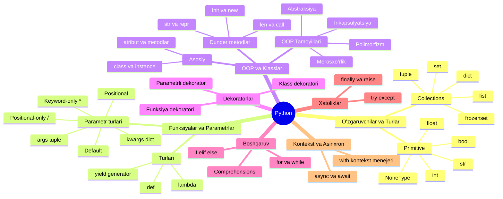

# 🌳 Python Asosiy Tushunchalari va Parametrlari (Daraxt Shaklida)

Ushbu qoʻllanmada Python dasturlash tilining asosiy qurilish bloklari — maʼlumot turlari, funksiya va parametrlar, klasslar (OOP), dekoratorlar va boshqa muhim konstruksiyalar daraxt (ierarxiya) koʻrinishida tizimlashtirilgan.

💼 **Ishga kirish (Intervyu) uchun chuqurlashtirilgan qoʻllanma:**  
👉 [Python Intervyu Tushunchalari Daraxti (python_tushunchalari_daraxti.md)](file:///home/shamsiddin/Documents/SCARPION/Learn-Backend/Python-naqshlari/python_tushunchalari_daraxti.md)

🚀 **Backend Dasturchi Texnologiyalar va Bilimlar Roʻyxati:**  
👉 [Backend Bilimlar Roʻyxati (BACKEND_BILIMLAR_ROYXATI.md)](file:///home/shamsiddin/Documents/SCARPION/Learn-Backend/Python-naqshlari/BACKEND_BILIMLAR_ROYXATI.md)

---

## 🌲 1. Umumiy Koʻrinish (ASCII Daraxti)

```text
Python
├── 📦 1. Oʻzgaruvchilar va Maʼlumot Turlari (Data Types)
│   ├── 🔹 Oddiy (Primitive)
│   │   ├── int (butun sonlar: 10, -5)
│   │   ├── float (oʻnlik sonlar: 3.14)
│   │   ├── str (matnlar: "Salom")
│   │   ├── bool (mantiqiy: True, False)
│   │   └── NoneType (qiymat yoʻqligi: None)
│   └── 🔹 Toʻplamlar (Collections / Data Structures)
│       ├── list (oʻzgaruvchan tartibli roʻyxat: [1, 2, 3])
│       ├── tuple (oʻzgarmas kortej: (1, 2, 3))
│       ├── dict (kalit-qiymat lugʻat: {"a": 1})
│       ├── set (takrorlanmas toʻplam: {1, 2, 3})
│       └── frozenset (oʻzgarmas toʻplam)
│
├── ⚙️ 2. Funksiyalar (Functions)
│   ├── 🔹 Funksiya turlari
│   │   ├── Standart funksiya (def my_func():)
│   │   ├── Nomsiz funksiya (lambda x: x * 2)
│   │   └── Generator funksiya (yield bilan oqimli uzatish)
│   └── 🔹 Parametrlar va Argumentlar turlari (Function Parameters)
│       ├── Pozitsion (Positional: func(a, b))
│       ├── Standart qiymatli (Default: func(a, b=10))
│       ├── Nomlangan (Keyword: func(b=5, a=2))
│       ├── *args (ixtiyoriy sonli pozitsion parametrlar - tuple)
│       ├── **kwargs (ixtiyoriy sonli nomlangan parametrlar - dict)
│       └── Maxsus chegaralar:
│           ├── / (Positional-only: chapdagilar faqat pozitsion)
│           └── * (Keyword-only: oʻngdagilar faqat nomlangan)
│
├── 🏛️ 3. Klasslar va OOP (Classes & Object-Oriented Programming)
│   ├── 🔹 Klass komponentlari
│   │   ├── class (shablon) va Instance (obyekt)
│   │   ├── Atributlar (Klass va Obyekt atributlari)
│   │   └── Metodlar (Instance method, @classmethod, @staticmethod)
│   ├── 🔹 4 ta OOP Tamoyili
│   │   ├── Inkapsulyatsiya (Encapsulation: public, _protected, __private)
│   │   ├── Merosxoʻrlik (Inheritance: class Child(Parent):)
│   │   ├── Polimorfizm (Polymorphism: bir xil metod, turli xatti-harakat)
│   │   └── Abstraksiya (Abstraction: abc moduli, Abstract Base Class)
│   └── 🔹 Sehrli metodlar (Dunder methods)
│       ├── Initsializatsiya: __init__, __new__
│       ├── Matnli ifoda: __str__, __repr__
│       └── Boshqalar: __len__, __call__, __getitem__, __eq__
│
├── 🎀 4. Dekoratorlar (Decorators)
│   ├── 🔹 Funksiya dekoratori (@my_decorator)
│   ├── 🔹 Parametr qabul qiluvchi dekorator (@repeat(num=3))
│   └── 🔹 Klass dekoratori (@dataclass, class wrapper)
│
├── 🔄 5. Boshqaruv Konstruksiyalari (Control Flow)
│   ├── 🔹 Shart operatorlari: if, elif, else
│   ├── 🔹 Sikllar (Loops):
│   │   ├── for (iteratsiya)
│   │   ├── while (shartli sikl)
│   │   └── Boshqaruv: break, continue, pass, else
│   └── 🔹 Comprehensions:
│       ├── List comprehension: [x for x in data]
│       ├── Dict comprehension: {k: v for k, v in data}
│       └── Set comprehension: {x for x in data}
│
├── 🛡️ 6. Xatoliklarni boshqarish (Exception Handling)
│   ├── try (xavfli kod bloki)
│   ├── except (xatoni ushlash)
│   ├── else (xato boʻlmaganda ishlaydi)
│   ├── finally (har qanday holatda ishlaydi)
│   └── raise (sunʼiy xato tashlash)
│
├── 📁 7. Modullar va Kontekst Menejerlari
│   ├── 🔹 Modullar & Paketlar: import, from ... import
│   └── 🔹 Kontekst menejeri: with open(...) as f: (__enter__, __exit__)
│
└── ⚡ 8. Asinxron Dasturlash (Async Programming)
    ├── async def (korutina yaratish)
    ├── await (natijani kutish)
    └── asyncio kutubxonasi (event loop boshqaruvi)
```

---

## 📊 2. Vizual Sxema (Mermaid Mindmap)



---

## 🔍 3. Har Bir Shoxcha Boʻyicha Qisqa Tavsif va Misollar

### 📦 1. Oʻzgaruvchilar va Maʼlumot turlari
```python
# Oddiy turlar
son = 42                 # int
baho = 4.5               # float
ism = "Ali"              # str
faolmi = True            # bool
qiymat = None            # NoneType

# Toʻplamlar
mevalar = ["olma", "anor"]           # list (oʻzgaruvchan)
koordinata = (41.2995, 69.2401)      # tuple (oʻzgarmas)
foydalanuvchi = {"ism": "Ali", "yosh": 20}  # dict (lugʻat)
raqamlar = {1, 2, 3, 3, 2}           # set -> {1, 2, 3} (takrorlanmas)
```

---

### ⚙️ 2. Funksiyalar va Parametrlar
Funksiya argumentlarini toʻliq nazorat qilish sintaksisi:

```python
# / gacha boʻlganlar faqat pozitsion, * dan keyingilar faqat nomlangan
def toliq_misol(pos_faqat, /, standart=10, *args, faqat_nomlangan, **kwargs):
    print(pos_faqat)
    print(standart)
    print(args)           # tuple
    print(faqat_nomlangan)
    print(kwargs)         # dict

# Ishlatilishi:
toliq_misol(1, 2, 3, 4, faqat_nomlangan="kalit", qoshimcha="qiymat")
```

---

### 🏛️ 3. Klasslar va OOP
```python
class Hayvon:
    def __init__(self, nomi: str):
        self.nomi = nomi      # Obyekt atributi

    def ovoz_ber(self):
        raise NotImplementedError("Voris klassda yozilishi shart")

class Mushuk(Hayvon):
    def ovoz_ber(self):       # Polimorfizm
        return f"{self.nomi}: Miyov!"

m = Mushuk("Momiq")
print(m.ovoz_ber())  # Momiq: Miyov!
```

---

### 🎀 4. Dekoratorlar
Funksiya kodiga tegmasdan unga qoʻshimcha imkoniyat berish:

```python
def tekshiruv(func):
    def wrapper(*args, **kwargs):
        print("--> Amal boshlandi")
        natija = func(*args, **kwargs)
        print("--> Amal yakunlandi")
        return natija
    return wrapper

@tekshiruv
def hisobla(a, b):
    return a + b

print("Natija:", hisobla(5, 7))
```

---

### ⚡ 5. Asinxron Dasturlash & Kontekst Menejeri
```python
# Kontekst menejeri (faylni xavfsiz avtomatik yopadi)
with open("test.txt", "w") as f:
    f.write("Salom!")

# Asinxron korutina
import asyncio

async def yuklash():
    await asyncio.sleep(1)
    return "Maʼlumot yuklandi"
```
