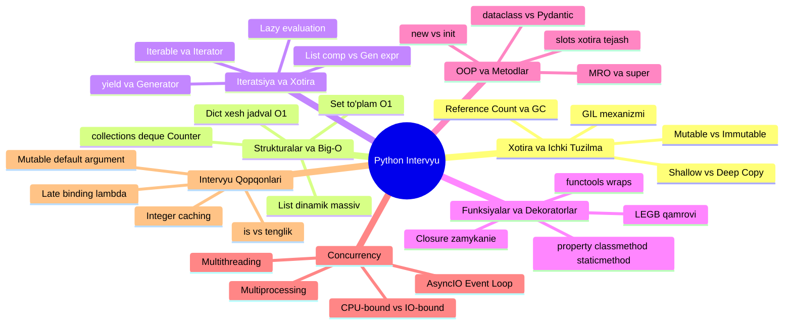

# 💼 Python Boʻyicha Ishga Kirish (Interview) Tushunchalari Daraxti

Ushbu qoʻllanma Python boʻyicha texnik intervyulardan (Junior / Middle darajadagi backend dasturchi suhbatlaridan) muvaffaqiyatli oʻtish uchun eng koʻp soʻraladigan barcha asosiy tushunchalar, ichki mexanizmlar, algoritmik murakkabliklar va intervyu qopqonlarini (gotchas) **daraxt (ierarxiya) shaklida** tizimlashtirib beradi.

---

## 🌲 1. Ishga Kirish Uchun Python Master Daraxti (ASCII)

```text
💼 PYTHON INTERVIEW ROADMAP DARAХTI
│
├── 🧠 1. Xotira Boshqaruvi va Python Ichki Mexanizmi (Under the Hood)
│   ├── 🔹 Hamma narsa — Obyekt (type, id, value)
│   ├── 🔹 Mutable vs Immutable
│   │   ├── Oʻzgaruvchan (Mutable): list, dict, set (in-place oʻzgaradi)
│   │   └── Oʻzgarmas (Immutable): int, float, str, tuple, bool, frozenset
│   ├── 🔹 Nusxalash: Oddiy tayinlash (=) vs Shallow copy vs Deep copy
│   ├── 🔹 Xotira tozalash (Memory Management):
│   │   ├── Reference Counting (havolalar sonini sanash)
│   │   └── Cyclic Garbage Collector (gc moduli - aylanma havolalarni tozalash)
│   └── 🔹 GIL (Global Interpreter Lock):
│       ├── Nima uchun kerak? (CPython xotira yaxlitligi)
│       └── Yechimlar: Multiprocessing, AsyncIO, C-kengaytmalar
│
├── ⚡ 2. Maʼlumot Tuzilmalari va Algoritmik Tezlik (Big-O Complexity)
│   ├── 🔹 List (Dinamik massiv):
│   │   ├── append(), pop() -> O(1)
│   │   └── insert(0), pop(0), search `in` -> O(n)
│   ├── 🔹 Dict va Set (Hash Table / Xesh jadvallar):
│   │   ├── Qidirish, qoʻshish, oʻchirish -> O(1) oʻrtacha
│   │   ├── Xesh toʻqnashuvi (Hash Collision) qanday hal qilinadi?
│   │   └── Kalit boʻlish sharti: Hashable (faqat immutable turlar)
│   └── 🔹 collections moduli (Seniorlar kodi):
│       ├── deque (ikki tomonlama navbat: appendleft, popleft O(1))
│       ├── defaultdict (yoʻq kalit uchun avtomatik standart qiymat)
│       ├── Counter (elementlar sonini hisoblash)
│       └── namedtuple (yengil, maydonli oʻzgarmas obyekt)
│
├── 🔁 3. Iteratsiya, Generatorlar va Xotira Tejamkorligi
│   ├── 🔹 Iterable vs Iterator:
│   │   ├── Iterable: `__iter__()` metodi bor toʻplam
│   │   └── Iterator: `__next__()` orqali navbatma-navbat beruvchi obyekt
│   ├── 🔹 Generatorlar va `yield`:
│   │   ├── Barcha elementlarni bir vaqtda RAMga yuklamaydi (Lazy evaluation)
│   │   └── Katta hajmdagi maʼlumot / fayllarni oqim (stream) sifatida oʻqish
│   └── 🔹 Generator Expression `(x for x in ...)` vs List Comprehension `[x for x in ...]`
│
├── 🎯 4. Qamrov (Scope) va Funksiyalar Chuqurligi
│   ├── 🔹 LEGB Qoidasi (Local -> Enclosing -> Global -> Built-in)
│   ├── 🔹 First-Class Citizens (Funksiya oʻzgaruvchi kabi uzatiladi va qaytariladi)
│   ├── 🔹 Closure (Qamrov / Zamykanie)
│   └── 🔹 global va nonlocal kalit soʻzlari
│
├── 🎀 5. Dekoratorlar (Decorators) — Intervyu Sevimlisi
│   ├── 🔹 Ishlash mexanizmi: Funksiyani qabul qilib, kengaytirib qaytarish
│   ├── 🔹 `@functools.wraps` — nima uchun shart? (metadata, docstring yoʻqolmasligi)
│   ├── 🔹 Parametrli dekoratorlar (3 qavatli funksiyalar)
│   └── 🔹 Klass metodlari dekoratorlari:
│       ├── `@property` (getter, setter, deleter)
│       ├── `@classmethod` (cls qabul qiladi, factory metodlar uchun)
│       └── `@staticmethod` (self yoki cls talab qilmaydigan yordamchi funksiya)
│
├── 🏛️ 6. Klasslar, OOP va Arxitektura
│   ├── 🔹 Ob-havo mexanizmi: `__new__` (yaratuvchi) vs `__init__` (boshlangʻich holat)
│   ├── 🔹 OOP 4 ustuni (Real Backend misollarida)
│   ├── 🔹 Koʻp tomonlama merosxoʻrlik (Multiple Inheritance):
│   │   ├── MRO (Method Resolution Order) va C3 Linearization
│   │   └── `super()` toʻgʻri chaqiruvi
│   ├── 🔹 `__slots__` — RAM xotirani 40-50% tejash texnikasi
│   └── 🔹 Klass turlari: Oddiy class vs `@dataclass` vs Pydantic `BaseModel`
│
├── 🚦 7. Concurrency: Koʻp vazifalilik (Multitasking)
│   ├── 🔹 I/O-bound vs CPU-bound farqi
│   ├── 🔹 Threading (Koʻp oqimlilik - I/O uchun)
│   ├── 🔹 Multiprocessing (Koʻp jarayonlilik - CPU hisob-kitoblar uchun)
│   └── 🔹 AsyncIO (Asinxron bir oqimli hamkorlik):
│       ├── Event Loop, Coroutine (`async def`), `await`
│       ├── `asyncio.gather()` va `asyncio.create_task()`
│       └── Nima uchun FastAPI / aiohttp Django WSGI dan tezroq?
│
└── 🪤 8. Intervyudagi Mashhur Qopqonlar (Interview Gotchas)
    ├── ⚠️ Mutable Default Argument: `def append_to(val, lst=[])`
    ├── ⚠️ `is` va `==` farqi (Identiklik vs Tenglik)
    ├── ⚠️ Late Binding in Closures: `[lambda: i for i in range(5)]`
    ├── ⚠️ Kichik butun sonlar keshlanishi (-5 dan 256 gacha)
    └── ⚠️ `try...finally` blokida `return` ishlatish xavfi
```

---

## 📊 2. Vizual Sxema (Mermaid Mindmap)



---

## 🔬 3. Boʻlimlar Boʻyicha Batafsil Tushuntirish, Kodlar va Intervyu Javoblari

---

### 🧠 1-BOʻLIM: Xotira Boshqaruvi va Python Ichki Mexanizmi

#### 1.1. Mutable (Oʻzgaruvchan) vs Immutable (Oʻzgarmas)

* **Immutable:** `int`, `float`, `str`, `tuple`, `bool`, `frozenset`. Qiymat oʻzgarsa — xotirada yangi manzil (yangi obyekt) yaratiladi.
* **Mutable:** `list`, `dict`, `set`. Obyekt xotiradagi oʻz oʻrnida (in-place) oʻzgaradi, uning ID si oʻzgarmaydi.

```python
# Immutable misoli:
a = "Salom"
eski_id = id(a)
a += " Dunyo"
print(eski_id == id(a))  # False! Yangi obyekt yaratildi

# Mutable misoli:
lst = [1, 2]
eski_id = id(lst)
lst.append(3)
print(eski_id == id(lst))  # True! Xuddi shu ro'yxat kengaytirildi
```

#### 1.2. Shallow Copy vs Deep Copy

```python
import copy

asl = [[1, 2, 3], [4, 5, 6]]

# 1. Yuzaki nusxa (Shallow copy) - ichki ro'yxatlarning faqat havolasini oladi
yuzaki = copy.copy(asl)
yuzaki[0][0] = 999
print(asl[0][0])  # 999! Asl ro'yxat ham o'zgarib ketdi!

# 2. Chuqur nusxa (Deep copy) - ichma-ich barcha obyektlarni alohida qayta yaratadi
asl2 = [[1, 2], [3, 4]]
chuqur = copy.deepcopy(asl2)
chuqur[0][0] = 777
print(asl2[0][0])  # 1! Asl ro'yxat xavfsiz qoldi
```

#### 1.3. GIL (Global Interpreter Lock) nima?

* **Intervyu savoli:** *"Pythonda multithreading CPU-bound ishlarni nima uchun tezlashtira olmaydi?"*
* **Javob:** CPython ichki xotirani boshqarishda (reference counting) poyga holatlari (race condition) yuz bermasligi uchun bir vaqtning oʻzida faqat **bitta** oqimga Python baytkodini bajarishga ruxsat beradi. Bu GIL deyiladi.
  * **I/O-bound** (tarmoq, fayl, maʼlumotlar bazasi): `threading` yoki `asyncio` zoʻr samara beradi, chunki kutish vaqtida GIL boshqa oqimga boʻshatiladi.
  * **CPU-bound** (matematik hisob, rasm qayta ishlash): `multiprocessing` kerak, chunki u har bir yadro uchun alohida Python jarayoni va alohida xotira ochadi.

---

### ⚡ 2-BOʻLIM: Maʼlumot Tuzilmalari va Algoritmik Tezlik (Big-O)

| Maʼlumot Tuzilmasi             | Qidirish (Search)  | Qoʻshish (Insert)                   | Oʻchirish (Delete)                    | Xususiyati                                |
| ------------------------------- | ------------------ | ------------------------------------ | -------------------------------------- | ----------------------------------------- |
| **`list`**              | $O(n)$           | Oxiriga: $O(1)$, Boshiga: $O(n)$ | Oxiridan: $O(1)$, Boshidan: $O(n)$ | Dinamik massiv, indeks boʻyicha $O(1)$ |
| **`dict`**              | $O(1)$ oʻrtacha | $O(1)$ oʻrtacha                   | $O(1)$ oʻrtacha                     | Xesh jadval (Hash table)                  |
| **`set`**               | $O(1)$ oʻrtacha | $O(1)$ oʻrtacha                   | $O(1)$ oʻrtacha                     | Xesh jadval, faqat takrorlanmas kalitlar  |
| **`collections.deque`** | $O(n)$           | Ikki chetiga: $O(1)$               | Ikki chetidan: $O(1)$                | Double-ended queue (navbatlar uchun)      |

#### Nega `dict` kaliti faqat Immutable boʻlishi kerak?

Lugʻat kalitni qidirishda uning xesh qiymatini (`hash(kalit)`) hisoblaydi. Agar kalit oʻzgaruvchan (mutable, masalan `list`) boʻlsa, uning xeshi oʻzgarib ketishi va xesh-jadval ichida u yoʻqolib qolishi mumkin edi. Shuning uchun faqat `hashable` (oʻzgarmas) turlar kalit boʻla oladi.

---

### 🔁 3-BOʻLIM: Generatorlar va Xotira Tejamkorligi

#### Generator va `yield` ning amaliy qudrati:

* **Intervyu savoli:** *"10 Gigabaytli log faylni 4 GB operativ xotirasi (RAM) bor serverda qanday oʻqiysiz?"*
* **Javob:** Generator orqali qatorma-qator oqim (stream) koʻrinishida oʻqiladi. `read()` emas, generator ishlatiladi:

```python
def log_oqish(fayl_nomi):
    with open(fayl_nomi, "r", encoding="utf-8") as f:
        for qator in f:
            if "ERROR" in qator:
                yield qator.strip()  # Xotiraga faqat bitta qator yuklanadi!

# Ishlatilishi:
for xato in log_oqish("katta_log.txt"):
    print("Topilgan xatolik:", xato)
```

---

### 🎀 4-BOʻLIM: Dekoratorlar va `@functools.wraps`

Suhbatda albatta toʻliq va professional dekorator yozish soʻraladi:

```python
import functools
import time

def vaqt_olchagich(func):
    """Funksiyaning ishlash vaqtini hisoblovchi professional dekorator"""
    @functools.wraps(func)  # Muhim: func ning nomi va docstringini saqlab qoladi
    def wrapper(*args, **kwargs):
        boshlanish = time.time()
        natija = func(*args, **kwargs)
        tugash = time.time()
        print(f"[{func.__name__}] ishlash vaqti: {tugash - boshlanish:.4f} soniya")
        return natija
    return wrapper

@vaqt_olchagich
def ogir_amal(n):
    """1 dan n gacha yig'indi"""
    return sum(range(n))

print(ogir_amal(10_000_000))
print(ogir_amal.__name__)  # "ogir_amal" (agar @wraps bo'lmasa "wrapper" bo'lib qolardi!)
```

#### `@property`, `@classmethod`, `@staticmethod` farqi:

```python
class Xodim:
    kompaniya = "Google"

    def __init__(self, ism, maosh):
        self.ism = ism
        self._maosh = maosh

    @property
    def maosh(self):
        """Getter: xodim.maosh deb xususiyat kabi chaqiriladi"""
        return f"${self._maosh}"

    @classmethod
    def kompaniyani_ozgartir(cls, yangi_nom):
        """Klass atributini o'zgartirish yoki alternativ konstruktor uchun"""
        cls.kompaniya = yangi_nom

    @staticmethod
    def soliq_hisobla(summa):
        """Klass yoki obyekt ma'lumotiga muhtoj bo'lmagan oddiy yordamchi funksiya"""
        return summa * 0.12
```

---

### 🏛️ 5-BOʻLIM: OOP, MRO va `__slots__`

#### 1. `__new__` vs `__init__`:

* `__new__(cls, ...)`: Obyektni xotirada **yaratuvchi** birinchi metod (static). U yangi obyekt namunasini (`instance`) qaytarishi kerak. (Singleton naqshida ishlatiladi).
* `__init__(self, ...)`: Yaratilgan obyektni boshlangʻich qiymatlar bilan **toʻldiruvchi** (initsializatsiya qiluvchi) metod.

#### 2. `__slots__` orqali xotirani tejash:

Pythonda obyektlar oʻz atributlarini dinamik ravishda `__dict__` nomli lugʻatda saqlaydi (bu xotiradan koʻp joy oladi). Millionlab obyektlar yaratilganda `__slots__` berilsa, lugʻat yaratilmaydi va RAM keskin tejaladi:

```python
class NuqtaSlots:
    __slots__ = ('x', 'y')  # Faqat shu ikkita atributga ruxsat, __dict__ yaratilmaydi

    def __init__(self, x, y):
        self.x = x
        self.y = y
```

---

### 🚦 6-BOʻLIM: Asinxron Dasturlash (AsyncIO)

* **Sinxron (Klassik):** Bir amal tugamaguncha navbatdagisi kutib turadi (bloklanadi).
* **Asinxron (AsyncIO):** Kutish vaqtida (masalan, API yoki DB dan javob kelguncha) protsessor bekor turmaydi, boshqa mijozning vazifasini bajaradi.

```python
import asyncio

async def fetch_data(id: int):
    print(f"[{id}] So'rov yuborildi...")
    await asyncio.sleep(2)  # Tarmoqdan javob kutish simulyatsiyasi
    print(f"[{id}] Ma'lumot keldi!")
    return {"id": id, "status": "OK"}

async def main():
    # 3 ta so'rovni bir vaqtning o'zida parallel yuborish
    # Jami vaqt: 6 soniya emas, 2 soniya ketadi!
    natijalar = await asyncio.gather(
        fetch_data(1),
        fetch_data(2),
        fetch_data(3)
    )
    print("Barcha natijalar:", natijalar)

# Ishga tushirish:
# asyncio.run(main())
```

---

### 🪤 7-BOʻLIM: Intervyudagi Eng Mashhur 4 ta Qopqon (Gotchas)

#### 1-Qopqon: Mutable Default Argument (Eng koʻp yiqitadigan savol!)

```python
# XATO USUL:
def qosh(element, royxat=[]):
    royxat.append(element)
    return royxat

print(qosh(1))  # [1]
print(qosh(2))  # [1, 2] -> Kutilmagan natija! Chunki standart argument funksiya ta'riflangan paytda BIR MARTA yaratiladi.

# TOʻGʻRI USUL:
def qosh_togri(element, royxat=None):
    if royxat is None:
        royxat = []
    royxat.append(element)
    return royxat
```

#### 2-Qopqon: `is` va `==` farqi

* `==` — obyektlarning **qiymati** tengligini tekshiradi (`__eq__` chaqiriladi).
* `is` — obyektlarning **xotiradagi manzili bir xilligini** tekshiradi (`id(a) == id(b)`).

```python
a = [1, 2, 3]
b = [1, 2, 3]

print(a == b)  # True (qiymatlari bir xil)
print(a is b)  # False (xotirada ikki xil joyda joylashgan!)

# None tekshirishda doim `is` ishlatiladi:
if x is None:
    pass
```

#### 3-Qopqon: Late Binding in Closures (Kech bogʻlanish)

```python
# Noto'g'ri:
funksiyalar = [lambda: i for i in range(3)]
print([f() for f in funksiyalar])  # [2, 2, 2] chiqadi! (Chunki i sikl oxirida 2 bo'lib qolgan)

# To'g'ri (standart qiymat orqali o'sha vaqtdagi qiymatni muhrlash):
funksiyalar = [lambda i=i: i for i in range(3)]
print([f() for f in funksiyalar])  # [0, 1, 2]
```

#### 4-Qopqon: Kichik Butun Sonlar Keshlanishi (Integer Caching)

CPython optimizatsiya maqsadida `-5` dan `256` gacha boʻlgan sonlarni oldindan xotirada keshlab qoʻyadi:

```python
x = 256
y = 256
print(x is y)  # True (bitta keshdagi obyektga ishora qiladi)

a = 257
b = 257
print(a is b)  # False (alohida obyektlar qilib yaratiladi)
```

---

## 🎯 8. Suhbatdan Oʻtish Uchun Qisqa Cheklist

1. **Nazariyani tushuntirishda** faqat taʼrif bilan cheklanmang, **"Nima uchun bu shunday qilingan?"** degan sababni ayting (masalan: *"GIL CPython'da reference counting'ni poygalardan himoyalash uchun kiritilgan"*).
2. **Katta maʼlumotlar** haqida soʻralsa — doim birinchi boʻlib **Generatorlar (`yield`)** va **Xotira samaradorligi (`__slots__`)** haqida gapiring.
3. **Kodni toza yozishda** — `type hints` (tiplar), `@functools.wraps`, xatoliklarni aniq ushlash (`except SpecificError`) va `with` kontekst menejerlaridan foydalaning.
